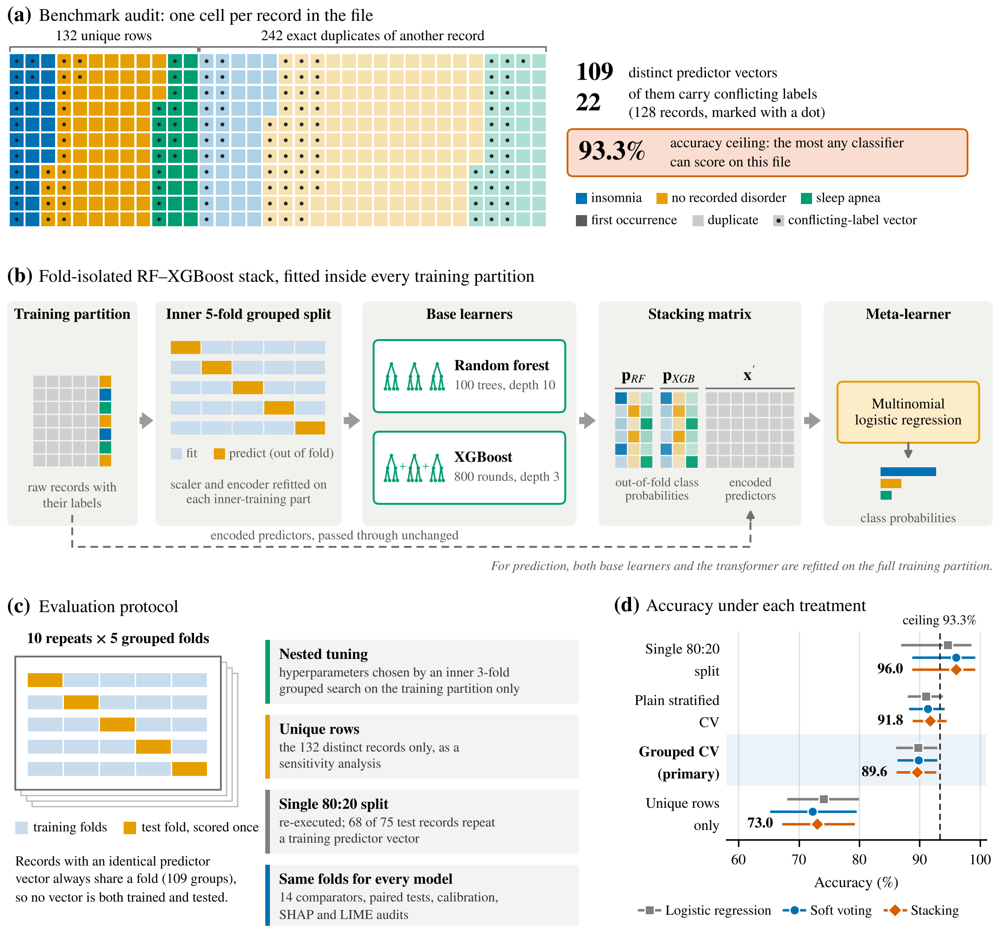
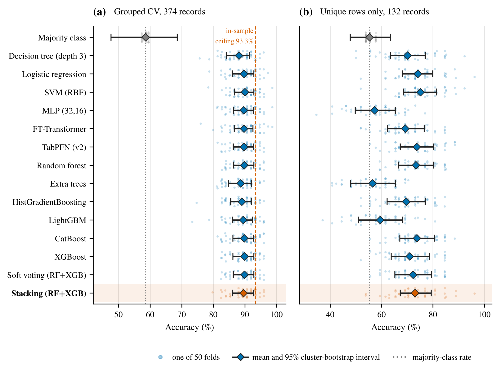
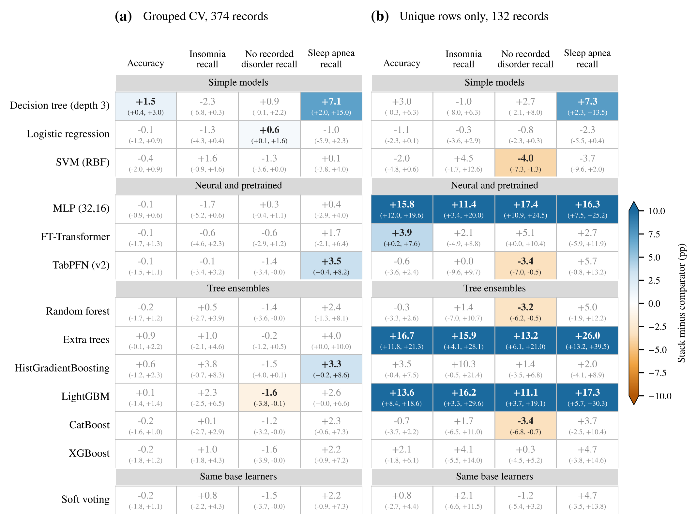
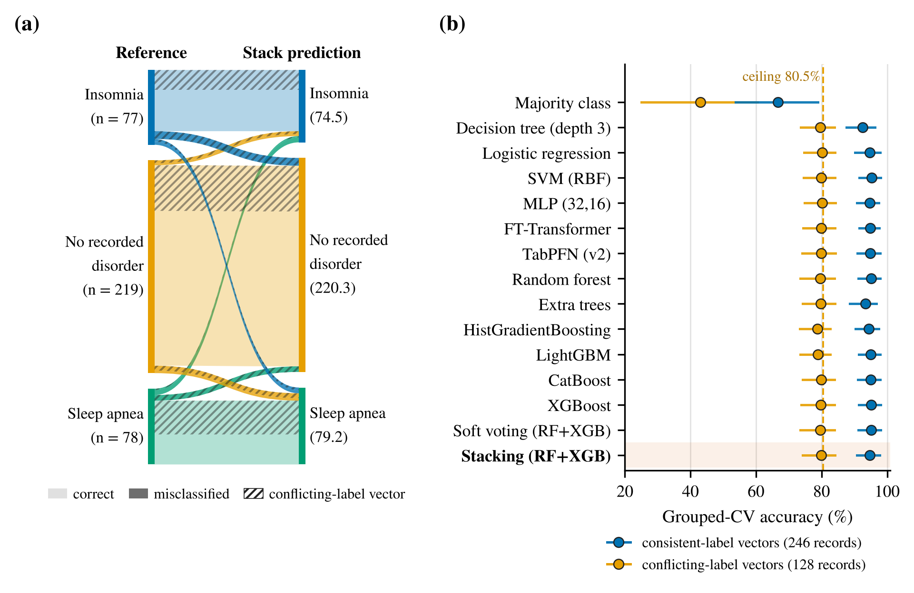
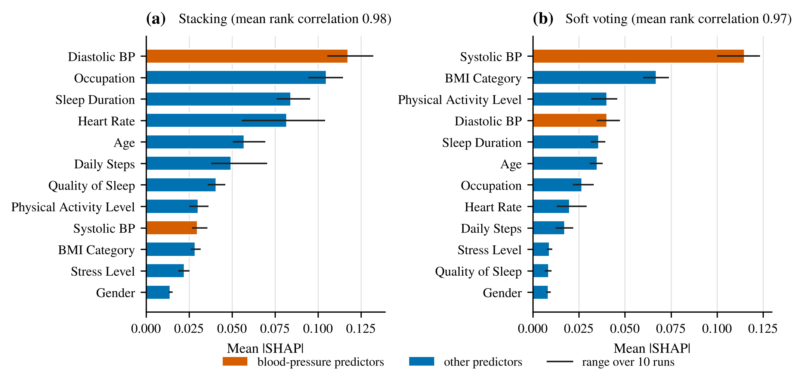

<div align="center">

# Explainable Stacking for Multiclass Sleep-Disorder Classification

### A leakage-controlled evaluation on the Sleep Health and Lifestyle Dataset

[Rifat Bin Reza](https://orcid.org/0009-0006-1865-8419)<sup>1</sup> · [Md Ahadul Haque Suvo](https://orcid.org/0009-0000-6756-4773)<sup>2</sup> · [Atair Rahman Alvi](https://orcid.org/0009-0006-5117-8599)<sup>1</sup>

<sup>1</sup> Brac University, Dhaka · <sup>2</sup> Aviation and Aerospace University, Dhaka

[](https://rifat-binreza.github.io/sleep_data_analysis_bracu_revised/)
[](LICENSE)
[](https://www.python.org/)
[](#citation)

**[Open the interactive results explorer →](https://rifat-binreza.github.io/sleep_data_analysis_bracu_revised/)**

</div>

<p align="center"></p>

## In one minute

This repository holds the code, the fold assignments, the out-of-fold predictions and every result table for a study of an explainable Random Forest–XGBoost stacking ensemble on a public sleep-health benchmark. The stack is compared with 14 other models on identical folds, with duplicate records kept out of the test folds.

| | |
|---|---|
| **374** records, of which **132** are unique rows | **109** distinct predictor vectors, **22** with conflicting labels |
| **93.3%** is the highest accuracy any model can reach on the file | **89.6%** stack accuracy under grouped cross-validation (95% CI 86.1–92.7) |
| No comparator is measurably better than the stack under either protocol | **66%** of the stack's errors fall on records with conflicting labels |

## Results

Ten repeats of five-fold grouped cross-validation. Records with identical predictor values always share a fold. Intervals are cluster-bootstrap intervals over predictor vectors.

| Model | Accuracy, grouped CV (%) | 95% CI | Macro-F1 | AUC | Brier | Accuracy, unique rows (%) |
|---|---:|---:|---:|---:|---:|---:|
| Majority class | 58.6 | 47.6–68.6 | 0.25 | 0.50 | 0.571 | 55.3 |
| Decision tree (depth 3) | 88.1 | 84.1–91.4 | 0.85 | 0.90 | 0.209 | 70.1 |
| Logistic regression | 89.7 | 86.0–92.8 | 0.87 | 0.92 | 0.188 | 74.1 |
| SVM (RBF) | 90.0 | 86.7–92.9 | 0.87 | 0.93 | 0.172 | 75.1 |
| MLP (32,16) | 89.7 | 86.5–92.6 | 0.87 | 0.91 | 0.188 | 57.3 |
| FT-Transformer | 89.7 | 86.6–92.6 | 0.87 | 0.91 | 0.190 | 69.2 |
| TabPFN (v2) | 89.7 | 86.3–92.7 | 0.86 | 0.93 | 0.172 | 73.7 |
| Random forest | 89.8 | 86.4–92.9 | 0.87 | 0.92 | 0.191 | 73.4 |
| Extra trees | 88.7 | 84.8–92.0 | 0.86 | 0.92 | 0.207 | 56.4 |
| HistGradientBoosting | 89.0 | 85.6–92.1 | 0.85 | 0.91 | 0.207 | 69.6 |
| LightGBM | 89.5 | 86.1–92.5 | 0.86 | 0.91 | 0.204 | 59.5 |
| CatBoost | 89.8 | 86.3–92.7 | 0.87 | 0.92 | 0.180 | 73.7 |
| XGBoost | 89.8 | 86.3–92.9 | 0.87 | 0.92 | 0.185 | 70.9 |
| Soft voting (RF+XGB) | 89.8 | 86.3–92.9 | 0.87 | 0.92 | 0.184 | 72.2 |
| **Stacking (RF+XGB)** | **89.6** | 86.1–92.7 | 0.87 | 0.91 | 0.186 | 73.0 |

<p align="center"></p>

### Stack against every comparator, overall and by class

A cell is coloured only where the 95% interval excludes zero. Intervals are not adjusted for the 104 comparisons.

<p align="center"></p>

### Where the errors fall

On the 246 records whose predictor values carry one label the stack is correct 94.7% of the time. On the 128 records whose predictor values carry conflicting labels it reaches 79.8%, against a ceiling of 80.5%. Every model shows the same pattern.

<p align="center"></p>

### Explanation stability

<p align="center"></p>

## Reproduce

```bash
git clone https://github.com/rifat-binreza/sleep_data_analysis_bracu_revised.git
cd sleep_data_analysis_bracu_revised
pip install -r requirements.txt

# rebuild every table, in-text number and figure from the released results (about a minute)
cd reproducibility_package
python code/build_tables.py
python code/perclass_diffs.py && python code/conflict_errors.py
python figure_scripts/fig_overview.py && python figure_scripts/figs_results.py && python figure_scripts/fig_lime_local.py

# or rerun the whole pipeline from the raw file (about an hour on two cores)
sh run_all.sh
```

Rebuilding from the released results reproduces every file in `paper_tables/` byte for byte.

TabPFN is evaluated on the same folds with a self-contained script for Kaggle; see [`reproducibility_package/tabpfn/TABPFN_GUIDE.md`](reproducibility_package/tabpfn/TABPFN_GUIDE.md). The executed run, with its outputs, is in [`tabpfn_kaggle_run.ipynb`](reproducibility_package/tabpfn/tabpfn_kaggle_run.ipynb).

## What is in the repository

| Path | Contents |
|---|---|
| `reproducibility_package/code/` | Audit, cross-validation, nested tuning, ablations, explanation audits, statistics, table builder |
| `reproducibility_package/results/` | Fold assignments, out-of-fold predictions for every model, summaries, paired comparisons |
| `reproducibility_package/figure_scripts/` | Scripts that draw the figures from the result files |
| `reproducibility_package/tabpfn/` | TabPFN script for Kaggle, its guide and the executed run |
| `reproducibility_package/data/` | The dataset file and its attribution |
| `paper_tables/` | Every table and in-text number, generated from the results |
| `figs/` | Figures as PDF and PNG |
| `docs/` | The interactive results explorer |

## Data

The [Sleep Health and Lifestyle Dataset](https://www.kaggle.com/datasets/uom190346a/sleep-health-and-lifestyle-dataset) by Laksika Tharmalingam is distributed on Kaggle under CC0 and is included unchanged. Its documentation describes it as synthetic data created for illustrative purposes. It contains questionnaire-style fields and no clinical adjudication, so the results here describe model behaviour on a benchmark. They are not estimates of diagnostic or screening performance.

## Citation

The manuscript is under review. Until it is published, please cite this repository:

```bibtex
@misc{reza2026sleepstacking,
  author = {Reza, Rifat Bin and Suvo, Md Ahadul Haque and Alvi, Atair Rahman},
  title  = {Explainable Stacking for Multiclass Sleep-Disorder Classification: A Leakage-Controlled Evaluation},
  year   = {2026},
  url    = {https://github.com/rifat-binreza/sleep_data_analysis_bracu_revised}
}
```

Contact: Rifat Bin Reza, rifat.bin.reza1@g.bracu.ac.bd

## License

Code is released under the [MIT License](LICENSE). The dataset is CC0.
